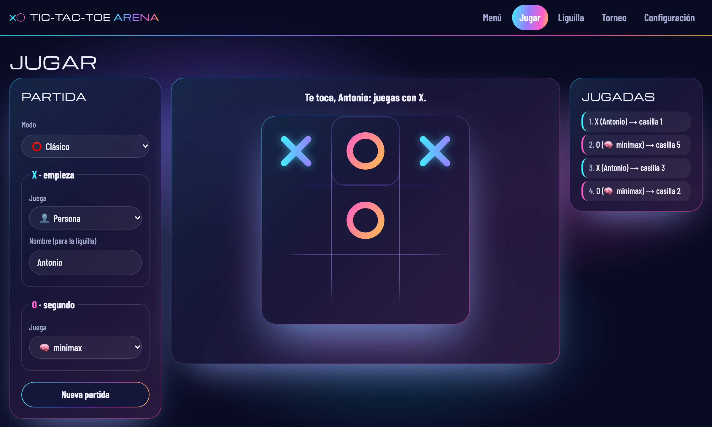

# Tic-Tac-Toe Arena

[](https://github.com/antonioorteu2014-create/tictactoe-arena/actions/workflows/tests.yml)
[](https://tictactoe-arena.readthedocs.io/)
[](LICENSE)

**▶ [Juega en el navegador](https://antonioorteu2014-create.github.io/tictactoe-arena/)** ·
**🏆 [Clasificación del torneo](https://antonioorteu2014-create.github.io/tictactoe-arena/#torneo)** ·
**📖 [Documentación](https://tictactoe-arena.readthedocs.io)**

El **tres en raya** como proyecto open-source. El juego es una librería de Python,
cualquiera puede programar su propio bot y enviarlo por pull request, y un torneo
automático enfrenta cada día a todos los bots y publica la clasificación en la web.
En la web se juega en **cuatro modos** (clásico, inverso, tres fichas y preguntas
de Inteligencia Artificial) y hay una liguilla de jugadores.



## Instalación

Requiere **Python 3.10 o superior**.

```bash
git clone https://github.com/antonioorteu2014-create/tictactoe-arena.git
cd tictactoe-arena
python3 -m venv .venv
source .venv/bin/activate
python -m pip install -e ".[dev]"
pytest                                # comprueba que todo funciona
```

En **Windows (PowerShell)**, las líneas del entorno son distintas:

```powershell
Set-ExecutionPolicy -Scope Process -ExecutionPolicy Bypass
python -m venv .venv
.venv\Scripts\Activate.ps1
python -m pip install -e ".[dev]"
pytest
```

## Jugar

- **En el navegador**, sin instalar nada:
  <https://antonioorteu2014-create.github.io/tictactoe-arena/>. Cuatro modos
  (clásico, inverso, tres fichas y preguntas de la asignatura), contra
  un bot, contra otra persona o bot contra bot, con liguilla de jugadores. Ver
  [Modos de juego](https://tictactoe-arena.readthedocs.io/es/latest/modes/) y
  [La web](https://tictactoe-arena.readthedocs.io/es/latest/web/).
- **En la terminal**, entre dos personas: `tictactoe-play`
  (en Windows, si no se reconoce, `python -m tictactoe`).
- **Desde Python**, sin ninguna interfaz:

```python
from tictactoe import game

state = game.initial_state()              # "........."
for move in [4, 1, 0, 2, 8]:              # casillas 0-8, por filas
    state = game.apply_move(state, move)
print(game.winner(state))                 # "X"
```

Las reglas completas están en [Reglas del juego](https://tictactoe-arena.readthedocs.io/es/latest/rules/).

## Bots y torneo

| Bot | Cómo decide |
|---|---|
| 🧠 `minimax` | Busca todas las jugadas futuras (poda alfa-beta): nunca pierde |
| 🦈 `voraz` | Gana si puede, bloquea si debe; no mira hacia delante |
| 🎲 `aleatorio` | Al azar: la referencia que cualquier bot debe superar |

Cada día, y cada vez que entra un cambio en `main`, todos los bots juegan contra
todos con X y con O, y la [clasificación](https://antonioorteu2014-create.github.io/tictactoe-arena/#torneo)
se publica sola en la web. Un bot que falla, hace trampa o se cuelga pierde esa
partida, pero no rompe el torneo.

```bash
tictactoe-tournament                              # el torneo en tu ordenador
python scripts/benchmark.py --games 100 --seed 0  # mide los bots entre sí
```

Más detalles en [Nuestros bots](https://tictactoe-arena.readthedocs.io/es/latest/bots/)
y [El torneo](https://tictactoe-arena.readthedocs.io/es/latest/tournament/).

## Escribe tu propio bot

1. Crea una clase que herede de `tictactoe.player.Player` e implemente
   `choose_move(state)`, que devuelve la casilla (0-8) donde jugar.
2. Guárdala en `players/custom/` y apúntala en `players/custom/players.yaml`.
3. Abre un pull request: las pruebas la examinan solas y, al fusionarla, entra en
   el torneo.

El paso a paso: [El API de jugador](https://tictactoe-arena.readthedocs.io/es/latest/upload-a-bot/player-api/)
y [Enviar tu bot](https://tictactoe-arena.readthedocs.io/es/latest/upload-a-bot/submit-a-player/).

## Estructura del proyecto

```
tictactoe-arena/
├── src/tictactoe/      # la librería: reglas, modos de juego, API de jugadores y torneo
├── players/            # los bots: builtin/ (del equipo) y custom/ (enviados)
├── web/                # la web: menú, jugar, liguilla y torneo (GitHub Pages + Pyodide)
├── scripts/            # benchmark.py (mide los bots) y build_web.py (empaqueta la web)
├── results/            # leaderboard.json de ejemplo (lo escribe tictactoe-tournament)
├── tests/              # pruebas automáticas (pytest)
├── docs/               # documentación (MkDocs → Read the Docs)
├── .github/            # pruebas en cada pull request y publicación diaria de la web
├── pyproject.toml      # descripción del paquete y de sus dependencias
└── mkdocs.yml          # configuración del sitio de documentación
```

Para probar la web en tu ordenador: `python scripts/build_web.py` y
`python -m http.server 8000 --directory web`, y abre <http://localhost:8000>.

## Contribuir, autores y licencia

La rama `main` está protegida: todo cambio llega por un pull request con una
revisión aprobatoria y las pruebas en verde. Ver [CONTRIBUTING.md](CONTRIBUTING.md).

Antonio Orteu, Álvaro Domingo y María Sanz — Inteligencia Artificial, 3.º MAT-A,
CUNEF Universidad (curso 2026/2027). Distribuido bajo la licencia [MIT](LICENSE).